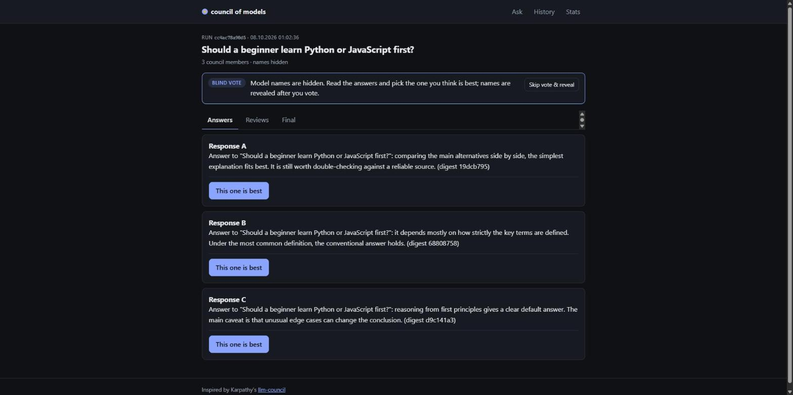
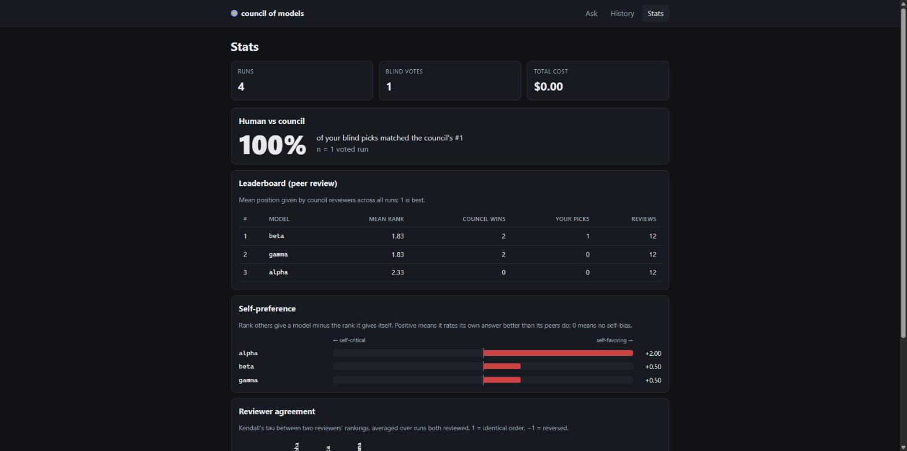

# council-of-models

**Ask several LLMs the same question, have them grade each other blind, and measure how biased the graders are.**

[](https://github.com/SelmanBoray/council-of-models/actions/workflows/ci.yml)
[](LICENSE)
[](https://www.python.org/downloads/)
[](https://github.com/karpathy/llm-council)

## Why

In November 2025 Andrej Karpathy shared [llm-council](https://github.com/karpathy/llm-council), a "99% vibe coded" Saturday hack: a question goes to GPT-5.1, Gemini 3 Pro, Claude Sonnet 4.5 and Grok 4 through OpenRouter, each model anonymously ranks the answers, and a chairman model writes the final reply. The most interesting part was a side note: the models fairly consistently ranked GPT-5.1 best and Claude worst, while his own reading disagreed (GPT-5.1 felt too wordy, Claude too terse). The judges had a taste, and it was not his.

This project takes that observation seriously: **don't just use LLMs as judges, measure the judges.** Every model ranks every answer, *its own included*; every run is stored; and the stats show who favors itself, which judges agree with each other, and how often the council agrees with you.



## How it works

```text
                         "Is a hot dog a sandwich?"
                                      |
 1. answer        +-------------------+-------------------+
                  v                   v                   v
               model 1             model 2             model 3       in parallel
                  |                   |                   |
 2. debate        +- read the others anonymously, revise -+          optional, N rounds
                  |                   |                   |
 3. review    every model ranks ALL answers, its own too, as "Response A, B, C"
         RANKING: B > A > C  RANKING: B > C > A  RANKING: C > B > A
                  |                   |                   |
                  +-------------------+-------------------+
                                      v
 4. synthesis          chairman reads answers + rankings  --->  final answer
                                      |
                  saved as data/runs/<id>.json  --->  judge-bias stats
```

Compared with the original hack, this re-implementation adds:

- **Provider-agnostic models**: OpenRouter, Anthropic, OpenAI, Ollama, plus an offline `fake` provider.
- **Debate rounds**: members read each other's anonymized answers and may revise before review.
- **Judge-bias analytics** over every stored run: self-preference index, reviewer agreement (Kendall tau), human-vs-council agreement, leaderboard, cost.
- **Blind human vote**: in the web UI you pick the best answer before model names are revealed.
- **Three surfaces**: a CLI, an MCP server for Claude Code / Cursor, and a web UI (FastAPI + React).

## Quickstart (30 seconds, no API key)

Not on PyPI yet, so install from source (Python 3.11+, a virtual environment is recommended):

```bash
git clone https://github.com/SelmanBoray/council-of-models.git
cd council-of-models
pip install -e ".[web,mcp,dev]"

council ask "Is a hot dog a sandwich?" --fake
council stats
```

`--fake` swaps the council for three deterministic offline models (`fake:alpha`, `fake:beta`, `fake:gamma`, with `fake:alpha` as chairman). Nothing leaves your machine. Ask a few different questions, then run `council stats`.

### With real models

One OpenRouter key covers every vendor. Without a `council.toml`, the default council is Karpathy's line-up (GPT-5.1, Gemini 3 Pro, Claude Sonnet 4.5, Grok 4; Gemini chairs).

```bash
export OPENROUTER_API_KEY=sk-or-...        # PowerShell: $env:OPENROUTER_API_KEY = "sk-or-..."
cp .env.example .env                       # alternative to export: fill in the key here; council loads ./.env
cp council.example.toml council.toml       # optional: edit members, chairman, debate rounds
council models                             # shows the council and which keys are set (never the values)
council ask "What is the best way to learn a new programming language?"
council ask "Should I use a monorepo?" --debate 1 --members openrouter:openai/gpt-5.1,openrouter:anthropic/claude-sonnet-4.5
```

The CLI reads a `.env` file from the directory you run `council` in. Variables already set in your environment take precedence, and empty values are ignored, so an untouched copy of [`.env.example`](.env.example) changes nothing. Other commands: `council history`, `council show <run_id>`, `council vote <run_id> <model>`, and `--json` on `ask` for scripting.

### Web UI

```bash
cd frontend && npm install && npm run build && cd ..    # once; needs Node 22.12+
council serve                                           # http://127.0.0.1:8000
council serve --fake                                    # offline fake council, no key needed
```

`--config <path>` (or `-c`) picks a config file, as with `ask`. Ask a question and watch each stage progress live. On the run page the answers appear as *Response A, B, C*: pick the best one, and only then are the names, the council's ranking and the chairman's synthesis revealed. Latency, token counts and cost stay hidden until you vote, because they can give a model away. The Stats page shows the leaderboard, self-preference bars, the agreement heatmap and your agreement rate with the council.



### MCP server (Claude Code, Cursor, ...)

```bash
claude mcp add council -- council-mcp
# or pass settings explicitly, since the client may not inherit your shell environment:
claude mcp add council -e OPENROUTER_API_KEY=sk-or-... -e COUNCIL_CONFIG=/path/to/council.toml -- council-mcp
# or try it offline with the fake council:
claude mcp add council -e COUNCIL_FAKE=1 -- council-mcp
```

For any other MCP client:

```json
{
  "mcpServers": {
    "council": { "command": "council-mcp" }
  }
}
```

Tools: `ask_council(question, debate_rounds=0)`, `council_stats()`, `council_history(limit=10)` and `council_vote(run_id, model)`. The server speaks MCP over stdio. A client may start it from any directory, so point `COUNCIL_CONFIG` at your config (or use `~/.config/council/config.toml`) and give it an absolute `data_dir`; then runs from your editor and from the CLI land in the same place. When the client starts `council-mcp` outside your project directory, pass keys through the client's `env` block (or `-e` flags) rather than relying on `.env`, which is only read from the directory the server starts in. If `council-mcp` is not on the client's `PATH`, use the full path to the script inside your virtual environment.

## What you get

The examples below are what the offline `fake` council produces. The fake provider is **deliberately biased** so the metrics have something to show: `fake:alpha` always ranks its own answer first, and the other two always rank alpha's answer last. Fake answers are deterministic text ending in an opaque digest (`(digest 1a2b3c4d)`) that lets the fake reviewers recognize authors without any visible model names, so the blind vote stays blind. Fake numbers prove the math works, nothing more. With real models, **the numbers only mean something after many runs**; across five questions, one odd question can flip a ranking.

**Self-preference index.** For each model and run: the mean position its peers gave its answer, minus the position it gave itself (1 = best), averaged over runs. Positive means the model rates itself higher than its peers do; zero means no self-bias.

| model        | self-preference |
| ------------ | --------------: |
| `fake:alpha` |           +2.00 |
| `fake:beta`  |           +0.50 |
| `fake:gamma` |           +0.50 |

Alpha scores +2.00, the maximum in a three-model council. Beta and gamma never promote themselves, yet score +0.50: alpha's ballot pushes both of them down one place, which makes their peers' average look worse than their own. One biased judge leaks into everyone else's score, so read this metric across the whole council, not only against zero.

**Reviewer agreement matrix.** Kendall's tau between two reviewers' rankings of the same answers, averaged over the runs both reviewed: +1 is the same order, 0 is unrelated, -1 is the reverse order.

|              | `fake:alpha` | `fake:beta` | `fake:gamma` |
| ------------ | -----------: | ----------: | -----------: |
| `fake:alpha` |         1.00 |       -0.33 |        -0.33 |
| `fake:beta`  |        -0.33 |        1.00 |         1.00 |
| `fake:gamma` |        -0.33 |        1.00 |         1.00 |

Beta and gamma share one notion of quality, so they agree perfectly. Alpha disagrees with both about exactly one thing: where alpha belongs. High agreement between real judges is not evidence of correctness; models trained on similar data can share the same blind spots.

**Human vs council.** The share of your blind votes that matched the council's #1 (the answer with the best mean position across all reviews). Only runs you voted on count; revealing names without voting keeps a run out. An illustrative example:

| run      | your blind pick | council's #1 | match |
| -------- | --------------- | ------------ | :---: |
| `a1b2c3` | `fake:gamma`    | `fake:gamma` |  yes  |
| `d4e5f6` | `fake:alpha`    | `fake:beta`  |  no   |
| `0718ab` | `fake:beta`     | `fake:beta`  |  yes  |

Agreement: 2 of 3 = 67%, n = 3. This is the number Karpathy's side note is about: if it stays low over many runs, the council's taste is not yours.

`council stats` and the Stats page also show a **leaderboard** (mean peer-review position per model, how many runs it won as the council's #1, how many reviews ranked it) and the **total cost** of all stored runs. Exact formulas and caveats: [docs/judge-bias.md](docs/judge-bias.md).

## Configuration

`council.toml` is looked up in this order: `--config <path>`, `./council.toml`, `~/.config/council/config.toml`, built-in defaults. Every key is optional; see [`council.example.toml`](council.example.toml).

| key             | type               | default                                  | meaning                                                                         |
| --------------- | ------------------ | ---------------------------------------- | ------------------------------------------------------------------------------- |
| `members`       | array of model ids | the four OpenRouter models above         | who answers and reviews; up to 26, no duplicates                                |
| `chairman`      | model id           | `openrouter:google/gemini-3-pro-preview` | writes the final answer; need not be a member; the first member if only `members` is set |
| `debate_rounds` | integer            | `0`                                      | revision rounds before review; each costs one call per member                   |
| `data_dir`      | path               | `./data`                                 | runs are stored as `<data_dir>/runs/<id>.json`; `~` is expanded                 |
| `max_tokens`    | integer            | `4096`                                   | output cap per call; reasoning models spend part of it on thinking              |

On the command line, `--members a,b,c`, `--chairman x` and `--debate N` override the file for one run.

## Providers

Model ids are `<provider>:<model>`. Everything after the first colon is the model name, so slashes and further colons are fine (`ollama:llama3.1:8b`).

| provider     | env var                  | example id                  | notes                                                                     |
| ------------ | ------------------------ | --------------------------- | ------------------------------------------------------------------------- |
| `openrouter` | `OPENROUTER_API_KEY`     | `openrouter:openai/gpt-5.1` | one key for every vendor; the only provider that reports cost per call    |
| `anthropic`  | `ANTHROPIC_API_KEY`      | `anthropic:claude-opus-5-5` | official `anthropic` SDK; tokens recorded, cost not                       |
| `openai`     | `OPENAI_API_KEY`         | `openai:gpt-5.1`            | Chat Completions API; tokens recorded, cost not                           |
| `ollama`     | `OLLAMA_HOST` (optional) | `ollama:llama3.1`           | local and free; defaults to `http://localhost:11434`                      |
| `fake`       | none                     | `fake:alpha`                | offline, deterministic, deliberately biased; `fake:fail...` always errors |

A missing key fails only the members that need it, at call time. A member that fails is excluded from later stages and the rest of the council carries on.

## Limitations

- **Cost multiplies.** One question costs N answers + N reviews + 1 synthesis, plus N calls per debate round: 9 calls for the default four-model council. Every review prompt contains every answer, so review input grows with council size.
- **LLM judges share biases.** They tend to reward length and confident style, may recognize their own writing despite anonymization, and are trained on overlapping data. The analytics measure these biases; they do not remove them.
- **Small-n statistics.** There are no confidence intervals yet. A handful of runs on similar questions tells you very little.
- **Rankings are relative.** Last place among four strong models can still be a good answer, and mean positions from councils of different sizes are not directly comparable.
- **Cost is partial outside OpenRouter.** Anthropic, OpenAI and Ollama report tokens but not prices, so a mixed council shows only the OpenRouter share of the cost.

## Roadmap

- [ ] PyPI release
- [ ] More judges per answer (judges that are not council members)
- [ ] Pairwise judging
- [ ] Elo ratings across runs
- [ ] Export runs and stats to CSV
- [ ] Docker image
- [ ] Hosted demo

## Contributing

Issues and pull requests are welcome. See [CONTRIBUTING.md](CONTRIBUTING.md) for the dev setup and [docs/architecture.md](docs/architecture.md) for how the pieces fit together. Every test runs offline, on the fake provider or mocked HTTP: `pytest -q` and `cd frontend && npm test`.

## License

[MIT](LICENSE) © 2026 Selman Boray Asiltürk

## Acknowledgements

- [Andrej Karpathy](https://github.com/karpathy) for [llm-council](https://github.com/karpathy/llm-council): the idea, the default council and the observation that started this project.
- [OpenRouter](https://openrouter.ai) for putting every frontier model behind one API key.
